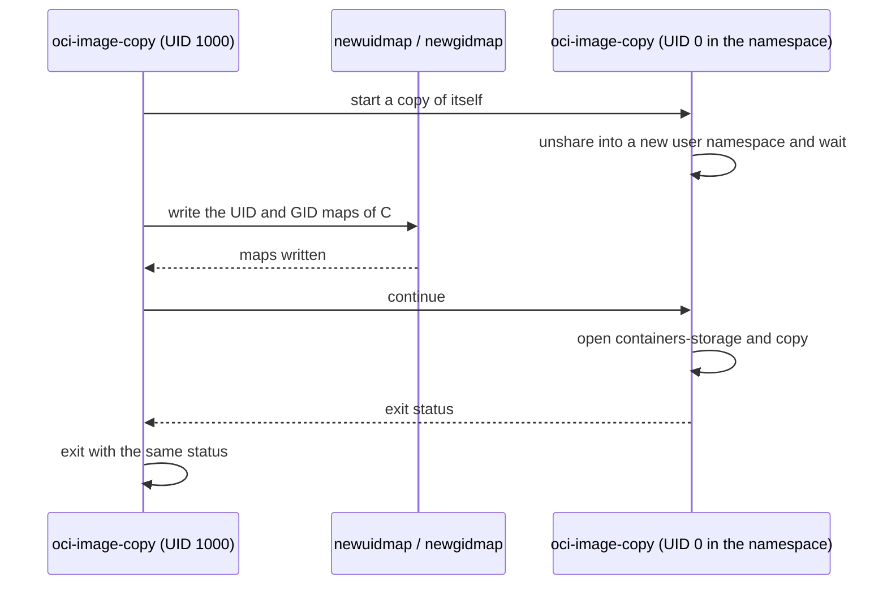

# Rootless containers-storage

A rootless podman keeps its images in `~/.local/share/containers/storage`.
The files inside those image layers belong to many UIDs and GIDs, not only to
the user who runs podman. An unprivileged process can create such files only
inside a user namespace that maps the user's subordinate ID ranges.

`oci-image-copy copy` does what podman does. When SRC or DST is
`containers-storage:` and the effective UID is not 0, it re-executes itself in
a new user namespace before it opens anything. The namespace maps the user to
UID 0 and the ranges from `/etc/subuid` and `/etc/subgid` after it. The
re-executed copy then opens the same store podman uses. The parent process
waits for it and exits with its status.



`oci-image-copy list` reads only stores, so it never re-executes.

## Requirements

- A binary built with cgo: `just build-dynamic ./cmd/oci-image-copy`.
  - go.podman.io/storage sets up the namespace in a C constructor.
  - A static build (`just build-static`) cannot enter a namespace. It stops
    with an error when a non-root user copies to or from containers-storage.
- `newuidmap` and `newgidmap`, installed setuid root or with file
  capabilities. Debian and Ubuntu ship them in `uidmap`; Fedora and RHEL in
  `shadow-utils`.
- Entries for the user in `/etc/subuid` and `/etc/subgid`, for example
  `alice:100000:65536`. Rootless podman needs the same entries.
- Unprivileged user namespaces allowed by the kernel and by the security
  module, as described below.

`podman unshare cat /proc/self/uid_map` prints the mapping when the host meets
the last three requirements. If podman works rootless for the user,
`oci-image-copy` works too, with one exception: an AppArmor policy that
restricts user namespaces per binary needs its own profile for
`oci-image-copy`.

The kernel limit `user.max_user_namespaces` must be above 0. RHEL 7 sets it
to 0:

```sh
echo 'user.max_user_namespaces = 28633' | sudo tee /etc/sysctl.d/90-userns.conf
sudo sysctl --system
```

## AppArmor

Ubuntu 23.10 and later restrict unprivileged user namespaces through AppArmor
(`kernel.apparmor_restrict_unprivileged_userns = 1`). A process may create
one only when its AppArmor profile grants the `userns` permission. Ubuntu
ships such profiles for programs like podman, so `oci-image-copy` needs a
profile of its own.

The check shows whether the restriction is active:

```sh
sysctl kernel.apparmor_restrict_unprivileged_userns
```

The profile below grants `userns` and leaves the binary otherwise unconfined.
Adjust the path to where the binary is installed. AppArmor matches the
profile by that path, so a copy elsewhere stays restricted.

```text
# /etc/apparmor.d/oci-image-copy
abi <abi/4.0>,
include <tunables/global>

profile oci-image-copy /usr/local/bin/oci-image-copy flags=(unconfined) {
  userns,

  include if exists <local/oci-image-copy>
}
```

Load it, or reload it after an edit:

```sh
sudo apparmor_parser -r /etc/apparmor.d/oci-image-copy
```

Setting `kernel.apparmor_restrict_unprivileged_userns = 0` also lifts the
restriction, for every program on the host. The per-binary profile is the
narrower choice.

## SELinux

Fedora, RHEL and CentOS Stream run interactive users as `unconfined_t`, which
may create user namespaces. Those users need no SELinux change.

A user mapped to a confined SELinux user, such as `user_u` (`user_t`) or
`staff_u` (`staff_t`), may lack the `create` permission of the
`user_namespace` class. Recent kernels check that permission when the loaded
policy enables the `userns` policy capability. Denials show up in the audit
log:

```sh
sudo ausearch -m AVC -ts recent | grep user_namespace
```

The module below allows `user_t` to create user namespaces. Replace `user_t`
with the domain the denial names.

```text
# ociimagecopy_userns.te
module ociimagecopy_userns 1.0;

require {
    type user_t;
    class user_namespace create;
}

allow user_t self:user_namespace create;
```

Build and install it:

```sh
checkmodule -M -m -o ociimagecopy_userns.mod ociimagecopy_userns.te
semodule_package -o ociimagecopy_userns.pp -m ociimagecopy_userns.mod
sudo semodule -i ociimagecopy_userns.pp
```

`sudo semodule -r ociimagecopy_userns` removes it again.

## Running as root

Root needs no user namespace. `sudo oci-image-copy copy ...` uses root's store
in `/var/lib/containers/storage`, which is a different store from the user's
rootless one.
